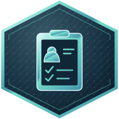

<h1 align="center">Connected remote examination</h1>

  
  

## Planned responsibility

Compose a patient and clinician encounter, declare a `MedCore.Profile` stream plan, establish a real WebRTC session via `med_ex` (`mf_rtc`), request a simulated device acquisition, reconcile preview disconnects against recording continuity, and commit the clinician-accepted observation with its FHIR export intent in one transaction.

## Direct workspace dependencies

[runtime](../../core/runtime/README.md), [store](../../core/store/README.md), [devices](../../core/devices/README.md), [rtc](../../core/rtc/README.md), [interop](../../core/interop/README.md), [web](../../core/web/README.md)

## First acceptance scenario

Run a two-browser call with a simulated acquisition, drop and reconnect the clinician preview mid-capture, deduplicate a repeated completion notification, review the intact recording, and verify a retried FHIR export.

[Workspace plan](../../README.md)
