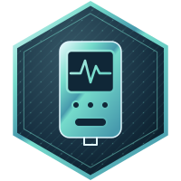

<p align="center">
  
</p>

<h1 align="center">Med Fabric Handheld</h1>

<p align="center">
  <a href="https://github.com/nshkrdotcom/med_fabric/tree/main/apps/handheld"></a>
  <a href="https://github.com/nshkrdotcom/med_fabric/blob/main/apps/handheld/LICENSE"></a>
</p>

`mf_handheld` is the standalone synthetic medical-peripheral client in
[Med Fabric](https://github.com/nshkrdotcom/med_fabric). Built on the base
[`med_ex`](https://hex.pm/packages/med_ex) SDK and `gun`, it owns synthetic
RDP1 acoustic/ECG and PLXS pulse-oximetry peripherals, a local command journal,
a bounded fsync-backed disk spool, and resumable TLS/WSS uplinks to `mf_exam`.

## Installation

Add `mf_handheld` to your list of dependencies in `mix.exs`:

```elixir
def deps do
  [
    {:mf_handheld, "~> 0.1.0"}
  ]
end
```

Requires Elixir `~> 1.20` (OTP 29), Linux with `util-linux` `flock`, a local
filesystem supporting directory `fsync`, and OTP TLS.

## Key Capabilities

- **Synthetic RDP1 & PLXS peripherals:** Exercises paired acoustic/ECG waveform
  streaming and spot-check pulse-oximetry collection with explicit source clock
  and calibration metadata.
- **Offline-first bounded spool:** Persists frames and measurement events into a
  local directory-locked spool (`MedExHandheld.Spool`) before uplink delivery;
  the measurement durability guarantee begins after handheld journal sync.
- **Resumable TLS/WSS transport:** Connects to `mf_exam` using device-scoped
  credentials and a pinned CA (`MedExHandheld.Transport`), replaying queued
  records after network interruption without duplicating accepted evidence.
- **Separate software monitor uplink:** Optionally streams latest-only 48 kHz
  monitor frames over an independent credit-paced WSS connection with a 200 ms
  local staleness cutoff.

## Quick Usage

From a compiled release or checkout, run a scenario via `MedExHandheld.CLI`:

```bash
bin/mf_handheld eval \
  'Application.ensure_all_started(:mf_handheld); MedExHandheld.CLI.main(["--config", "/etc/handheld/fixture.json", "--scenario", "paired_exam"])'
```

## Guides

- [Getting Started](https://mf-handheld.hexdocs.pm/0.1.0/getting_started.html) — Fixture configuration, TLS
  credentials, and CLI scenarios.
- [Spool & Recovery](https://mf-handheld.hexdocs.pm/0.1.0/spool_and_recovery.html) — Disk spool layout, journal
  sync guarantees, and reconnect replay.
- [Deployment](https://mf-handheld.hexdocs.pm/0.1.0/deployment.html) — Building and shipping a standalone Mix
  release without a server checkout.

## License

Released under the [MIT License](https://github.com/nshkrdotcom/med_fabric/blob/main/apps/handheld/LICENSE).
