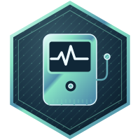

<h1 align="center">Device capabilities and acquisition</h1>

  
  

## Planned responsibility

Map gateway and simulated-device messages onto capability descriptions and acquisition events. Track requested, active, completed and failed acquisitions with device and calibration provenance.

## Direct workspace dependencies

[domain](../domain/README.md)

## First acceptance scenario

Exercise disconnect, stale measurement and duplicate delivery with a simulated device.

[Workspace plan](../../README.md)
