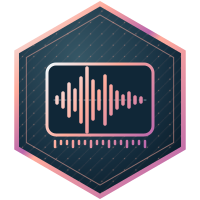

<h1 align="center">Signal profiles and recording</h1>

  
  

## Planned responsibility

Describe sample rate, channel layout, encoding and quality flags for each acquisition profile. Keep the original recording and the conversational preview independently identifiable. Membrane adapters belong here.

## Direct workspace dependencies

[domain](../domain/README.md)

## First acceptance scenario

Verify sample continuity and detect gaps before accepting a recording.

[Workspace plan](../../README.md)
