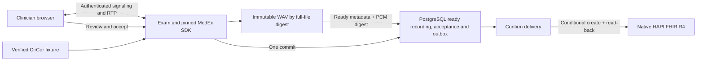

# Native browser-to-record lab

This lab associates a versioned PhysioNet fixture with a synthetic encounter in an explicitly enabled localhost app. MedEx provides capture, Opus RTP, and the browser hook. Med Fabric owns the encounter, PostgreSQL commit, and FHIR delivery.

The exam supervisor starts PubSub, Postgrex, a capture runner, and the Phoenix endpoint. The channel owns its peer. The capture task owns acquisition completion, with a bounded best-effort preview worker. The runner holds only the active task and its last failure. The SDK installs immutable WAVs by complete-file hash and returns a separate PCM digest. PostgreSQL owns ready metadata, conflicting evidence, reviewer identity and the export row. Review fetches and verifies the bytes before acceptance. Delivery uses seeded synthetic references and manual retry. Keep the artifact directory and service state across restarts.

## Setup on Ubuntu 26.04

1. Install `git curl tar build-essential pkg-config libssl-dev ca-certificates jq openssl postgresql-18 postgresql-client-18`. Use a non-root account for the isolated PostgreSQL cluster. Have `uv` on PATH. A fresh clone needs network access to GitHub, Hex and the upstream fixture and tool distributions.
2. With asdf or mise, activate the Erlang and Elixir versions in `.tool-versions` and Node `24.19.0`. For native HAPI, choose Temurin `21.0.9+10` and activate a full JDK. For example, `mise install java@temurin-21.0.9+10` and `export JAVA_HOME="$(mise where java@temurin-21.0.9+10)"`. The HAPI build pins and checksums the upstream source and Maven distribution.
3. Run `./onboard.sh --integration` from Fabric. The browser installation needs Chromium host libraries. If missing, run `ops/browser/node_modules/.bin/playwright install-deps chromium` with appropriate system privileges and retry. `./onboard.sh` alone prepares ordinary Mix checks.
4. Run `ops/verify_browser.sh`. It starts disposable local PostgreSQL 18 and JVM HAPI if service URLs are absent. To reuse dedicated test services, export both `DATABASE_URL` and `FHIR_BASE_URL`; they must be safe for synthetic test data. Service ports default to 15432 and 18080, with `MF_POSTGRES_PORT` and `MF_HAPI_PORT` overrides. `MF_HTTP_PORT` defaults to 14000. It prepares the pinned SDK's fixture, starts the normal exam process, proves real browser audio before and after preview replacement, verifies the artifact hash, restarts the exam before acceptance, verifies the recovered WAV, delivers once, then restarts the exam and its owned file-backed HAPI receiver for independent read-back. It records its run directory under `_build`. Use `ops/verify_browser.sh --release` to exercise the assembled Mix release through the same browser check.

## Focused checks

- `cd core/domain && mix test` checks the reviewed file identity and conflict gate.
- `cd core/store && mix test integration` exercises PostgreSQL rollback, concurrent duplicates, reconnect, and delivery state. Set `DATABASE_URL` first.
- `cd core/interop && mix test integration` proves one real HAPI resource after the response to an accepted write is discarded. Set `FHIR_BASE_URL` first.
- `mix test`, `mix quality`, and `mix weld.verify` from the root cover ordinary child checks and the library projection. The browser runner exercises the actual exam path.

## Manual listening check

1. Export `JAVA_HOME` and run `native_env=$(ops/local_services.sh start) && eval "$native_env"`. Prepare data with `bash apps/exam/deps/med_ex/priv/fixtures/prepare.sh "$PWD/_build/circor"`.
2. In the root shell export `MF_LAB=1`, `MF_EXAM_ID=manual-$(openssl rand -hex 8)`, `MF_LAB_ACCESS_KEY=$(openssl rand -hex 24)`, `MF_SECRET_KEY_BASE=$(openssl rand -hex 48)`, `MF_FIXTURE_DIR=$PWD/_build/circor`, and `MF_ARTIFACT_DIR=$PWD/_build/manual-recordings`. Set `export MF_REFS_FILE=$MF_ARTIFACT_DIR/$MF_EXAM_ID-refs.json`. Run `mkdir -p "$MF_ARTIFACT_DIR" && (cd apps/exam && env -u MF_LAB mix run --no-start ../../ops/seed_exam.exs) && (cd apps/exam && mix run --no-halt)`.
3. Open `http://127.0.0.1:4000/encounters/$MF_EXAM_ID?key=$MF_LAB_ACCESS_KEY` with the variable values substituted. Select **Play preview**, then **Start capture**. Listen for the fixture, disconnect preview, and reconnect before capture finishes. Listen for audio after reconnect. Capture should remain active across preview loss.
4. Play the finalized recording and verify its displayed continuity. Select **Accept recording**, refresh, and select **Deliver to FHIR**. Check the read-back count and recording digest with the automated runner or an identifier search on the test server. Record the browser version, whether audio was audible, encounter ID, and remote reference.
5. Stop the exam process and run `ops/local_services.sh stop` for the local services you started.
