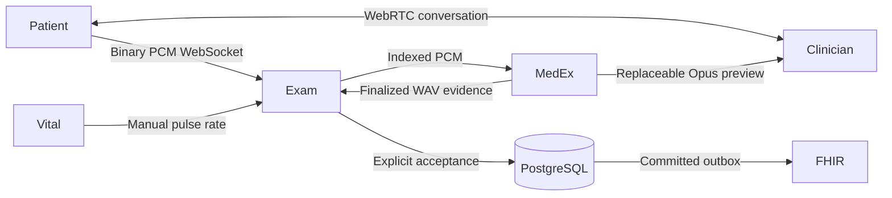

# Architecture and roadmap

Med Fabric owns clinical encounters, authorization, review, durable observations,
and healthcare record export. `apps/exam` (`mf_exam`) is the composition root: it
depends on [MedEx](https://github.com/nshkrdotcom/med_ex) for live media capture
and diagnostic preview, PostgreSQL for authoritative clinical state, and an
external HL7 FHIR R4 server for delivery. The three core clinical libraries
(`core/domain`, `core/store`, `core/interop`) remain independent of `apps/exam`.

## Exam composition

In `0.1.0`, one authorized encounter composes three independent paths:

1. **Two-way conversation:** Direct browser-to-browser WebRTC audio talkback
   between patient and clinician, authorized and signaled by `apps/exam`.
2. **Live diagnostic audio capture:** Patient browser `AudioWorklet` streams
   indexed 48 kHz mono PCM16LE over an authenticated binary WebSocket to
   `PCMSocket`, which feeds `MedEx.Capture` (immutable WAV writer + bounded
   live `Membrane.Opus.Encoder` preview over a replaceable `MedEx.Preview` peer).
3. **Fileless vital measurement:** Clinician-entered pulse rate with timestamp
   and explicit manual provenance—zero WAV file dependency.

An encounter outlives its peer connections. A diagnostic acquisition owns its
capture lifetime; browser disconnects only affect live preview availability.
After evidence is finalized and stored, PostgreSQL owns review, acceptance, and
export status across application restarts. Acceptance and its FHIR delivery
intent commit in one SQL transaction; FHIR HTTP runs outside that transaction
and outside LiveView.

## State and effects review

| Owner | State and reason |
| --- | --- |
| `MedEx.Capture` | Temporary `.part` WAV writer, next expected sample index, running PCM SHA-256, and single-frame preview demand. Enforces byte order, detects source loss, and keeps preview bounded. |
| `PCMSocket` & `ActiveCapture` registry | `PCMSocket` owns one admitted patient PCM WebSocket. The unique registry entry prevents overlapping captures on the same encounter and lets a reconnecting clinician locate the live capture. Neither owns ready evidence. |
| `SignalingChannel` | One `MedEx.Preview` peer, per-peer RTP packet sequence, and monotonic 48 kHz media clock. A replacement peer starts a fresh transport sequence. |
| PostgreSQL (`core/store`) | Encounter membership, typed evidence + provenance, accepted observations, and FHIR outbox intents. Row locks serialize review and acceptance. The exam verifies immutable WAV bytes before entering the acceptance transaction. |
| LiveView & browser | Presentation state, user actions, and ephemeral media handles. FHIR HTTP runs in an async delivery action; PostgreSQL owns the delivery outcome. |

The release verifier configures one test encounter with distinct, server-bound
actor identities and role keys. Integrate real identity-provider authentication
and multi-encounter routing before operating beyond a controlled lab.

## PostgreSQL schema and invariants

`core/store/priv/sql/002_evidence.sql` defines four tables (applied idempotently
via `MedFabric.Store.Postgres.migrate/0` under an advisory transaction lock):

| Table | Purpose & key invariants |
| --- | --- |
| `encounters` | Encounter ID (`PK`), `patient_actor`, `clinician_actor`, and nullable `closed_at`. |
| `acquisitions` | `(encounter_id, id)` `PK`, `evidence` (`jsonb`), and `conflict` flag. SQL `CHECK` constraints enforce required `kind` and `provenance` object, requiring `artifact_key` + `file_sha256` for `audio_pcm16_wav` and forbidding artifact fields while requiring numeric `value` for `pulse_rate`. |
| `observations` | `(encounter_id, acquisition_id)` `PK` referencing `acquisitions`, `actor`, and `accepted_at`. Guarantees at most one accepted observation per acquisition; late conflicts cannot overwrite accepted records. |
| `outbox_deliveries` | `(encounter_id, acquisition_id)` `PK` referencing `observations`, `destination`, `external_id`, `resource` (`jsonb`), `remote_ref`, and `last_error`. Enforces `UNIQUE (destination, external_id)` for idempotent FHIR retries. |

`core/store` performs PostgreSQL transactions only—it performs no filesystem
`File.read/1` calls and no HTTP calls.

## HL7 FHIR R4 mapping and confirmation

`MedFabric.Interop.FhirClient` maps accepted clinical observations to FHIR R4
`Observation` resources and delivers them via conditional create
(`POST /Observation` with `If-None-Exist: identifier=urn:med-fabric:observation|<external_id>`
and `Prefer: return=representation`), followed by strict typed field read-back
confirmation (rejecting unexpected clinical modifiers or conflicting values):

| Evidence `kind` | FHIR `code` | FHIR value & `method` |
| --- | --- | --- |
| `pulse_rate` | LOINC `8867-4` (`http://loinc.org`) | `valueQuantity` in UCUM `/min` (`beats/minute`), method `"Manually entered measurement"`. |
| `audio_pcm16_wav` | `reviewed-auscultation-recording` (`https://med-fabric.local/fhir/CodeSystem/exam-observation`) | `valueString` set to `file_sha256`, method `"Reviewed diagnostic audio recording"`. |

## Capability families and 12-use-case roadmap

| Family | Shared requirements | Target use cases | 0.1.0 coverage vs. planned gaps |
| --- | --- | --- | --- |
| Clinical collaboration | Session roles, real-time media, annotations, escalation | Connected telehealth exam (3), ultrasound & imaging (6), tele-EMS (7), speech therapy (9), procedural guidance (12) | **0.1.0:** Patient–clinician 1:1 WebRTC audio talkback + role separation. **Planned:** Video tracks, multiparty SFU, annotations, real IdP/RBAC, multi-encounter routing. |
| Device acquisition & monitoring | Source identity, timing, calibration, typed evidence | Digital stethoscope (1), RPM (4), respiratory devices (8), device troubleshooting (10), hearing/assistive devices (11) | **0.1.0:** Browser 48 kHz mono PCM16LE audio + manual pulse-rate evidence in one encounter. **Planned:** Hardware USB/BLE device gateways, multi-channel ECG/SpO₂ telemetry, calibration & control channels. |
| Clinical audio & signal processing | Signal fidelity, timing, lossless recording, quality checks | Digital stethoscope (1), voice monitoring (2), respiratory devices (8), speech therapy (9), hearing/assistive devices (11) | **0.1.0:** Bit-exact lossless WAV capture independent of live Opus preview + peer replacement recovery. **Planned:** Bell/diaphragm filtering, clipping/SNR QC, waveform review UI, out-of-band signal workers. |
| AI-assisted workflows | Consent, model provenance, explicit clinician review, escalation | Voice monitoring (2), medical voice assistants (5) | **0.1.0:** Explicit clinician acceptance + persisted provenance structure. **Planned:** Derived-result provenance schema constraints, ASR/TTS/VAD voice pipelines, model workers, escalation rules. |

## Extension boundaries

[MedEx](https://github.com/nshkrdotcom/med_ex/blob/main/guides/architecture_and_roadmap.md)
owns live media capture and preview transport. Out-of-band waveform processing
and inference (such as future NeuroKit2 or WFDB-Python workers, ONNX/Ortex
models, or Pipecat/whisper.cpp voice pipelines) are **out of scope for 0.1.0**;
when built, they will run as separately deployed workers or opt-in packages
consuming finalized artifacts outside capture and submitting derived results
with source digest and algorithm provenance into Fabric's review workflow.
LiveKit fits at the multiparty SFU boundary when needed; Orthanc fits at the
DICOM imaging/export boundary.

The `0.1.0` exam deploys as an OTP Mix release. Keeping `core/domain`,
`core/store`, and `core/interop` decoupled from `apps/exam` preserves the option
to package and publish a reusable `:med_fabric` Hex library later once a second
application defines its public library API.

See [Browser to record](browser_to_record.md) for prerequisites, release
deployment, verification, and the manual listening check.
