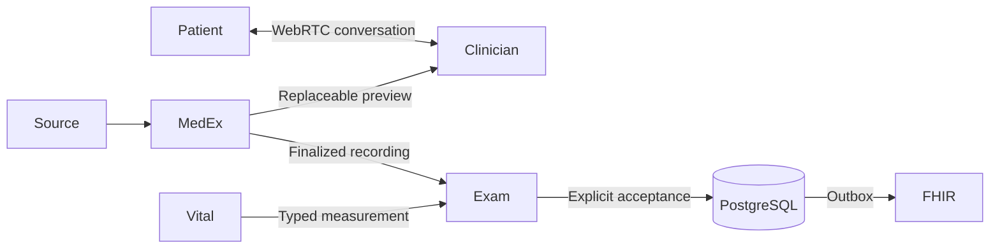

# Architecture and roadmap

Med Fabric owns clinical encounters, authorization, review, durable observations and export. The exam is the composition root. It uses MedEx for acquisition and diagnostic preview, PostgreSQL for clinical state and an external FHIR receiver for delivery. The clinical libraries remain independent of the exam application.

## Exam composition

The exam composes live diagnostic intake, a separate patient–clinician call and a fileless pulse-rate observation in a single authorized encounter.

An encounter outlives its peer connections. A diagnostic acquisition owns its own capture lifetime. A browser disconnect changes live preview availability. A capture outcome establishes recording completeness. After evidence is ready, PostgreSQL owns review, acceptance and export status across application restarts. Acceptance and its delivery intent commit together. FHIR HTTP runs outside that transaction.

## Capability families

| Family | Shared requirements | Use cases |
| --- | --- | --- |
| Clinical collaboration | Session roles, real-time media, annotations and escalation | Connected telehealth exam (3), ultrasound and imaging (6), tele-EMS (7), speech therapy (9), procedural guidance (12) |
| Device acquisition and monitoring | Source identity, timing, calibration, acquisition and typed evidence | Digital stethoscope (1), remote patient monitoring (4), respiratory devices (8), device troubleshooting (10), hearing and assistive devices (11) |
| Clinical audio and signal processing | Signal fidelity, timing, recording and quality evidence | Digital stethoscope (1), voice monitoring (2), respiratory devices (8), speech therapy (9), hearing and assistive devices (11) |
| AI-assisted workflows | Consent, model provenance, explicit review and escalation | Voice monitoring (2), medical voice assistants (5) |

## Extension boundaries

MedEx owns sample capture and media transport. Evidence processing can later run outside capture against finalized artifacts. Future NeuroKit2 or WFDB-Python integrations would handle waveform analysis or interchange. ONNX and voice processing would have separate runtime dependencies and provenance. Fabric owns review of any resulting clinical information. LiveKit would provide an external multiparty media plane when needed. Orthanc would sit at the imaging and export boundary.

The first release exercises one live audio profile and one manually entered vital. ECG, imaging, automated inference and device control remain planned. A future Fabric library distribution will need its own public API and package verification. The exam deploys as a Mix release.

See [Browser to record](browser_to_record.md) for the current native verification workflow.
