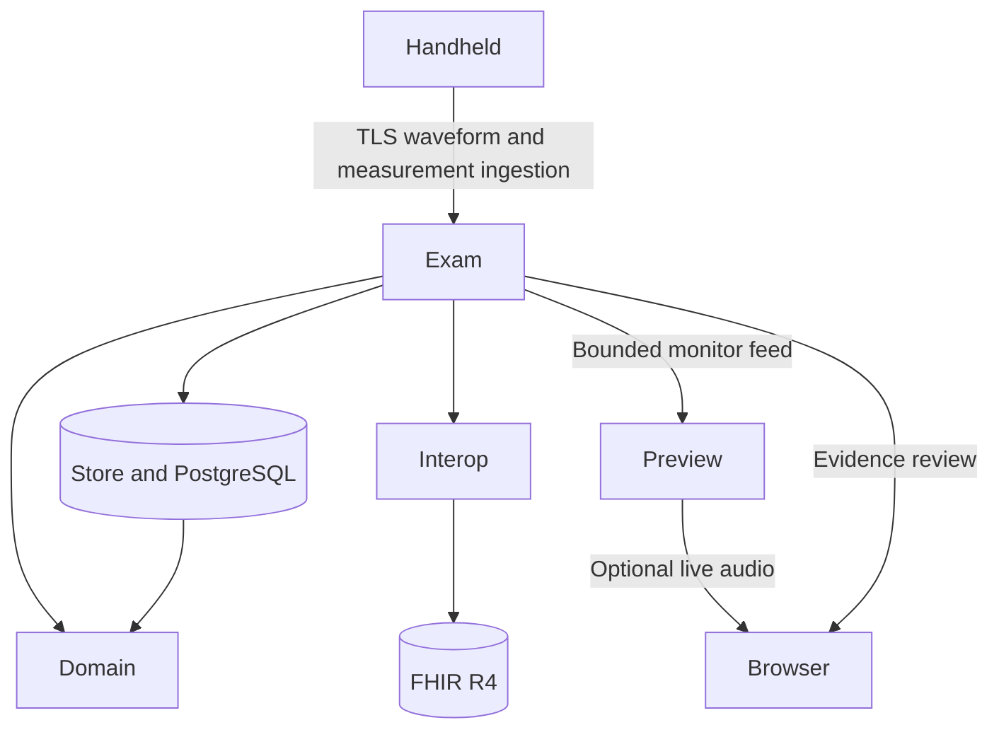
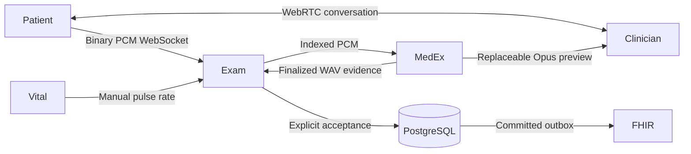

# Architecture and roadmap

Med Fabric owns clinical encounters, authorization, review, durable observations,
and healthcare record export. `apps/exam` (`mf_exam`) is the composition root: it
uses [MedEx](https://github.com/nshkrdotcom/med_ex) for source capture and
device contracts, PostgreSQL for authoritative clinical state, and an external
HL7 FHIR R4 server for delivery. The domain, store, and interoperability
libraries are independent of Exam.

Exam and Handheld use MedEx base in their default Mix projects. Preview
has its own release and selects the base plus the Opus and RTC providers.
The browser examination can instead use the explicit legacy media
profile in Exam. The root workspace provides development orchestration.

## Handheld acquisition

The standalone Handheld application owns its synthetic source clocks, local
command journal and durable spool. Exam admits device and stream descriptors
against the encounter grant. It acknowledges covered durable prefixes, and
Handheld replays its retained records over TLS following an interruption.
The review binds the immutable capture manifest, including explicit gaps and
clock uncertainty. For spot checks, accepting eligible measurements creates
independently retryable FHIR outbox entries in the same transaction as review.

The optional Preview application runs in a separate BEAM and receives
disposable monitor data. The authoritative PCM and journal remain with Exam.
See the [handheld guide](handheld_demo.md) and [preview guide](preview_isolation.md).

## Browser examination

An authorized browser encounter composes three independent paths.

1. **Two-way conversation:** Direct browser-to-browser WebRTC audio talkback
   between patient and clinician, authorized and signaled by `apps/exam`.
2. **Live diagnostic audio capture:** Patient browser `AudioWorklet` streams
   indexed 48 kHz mono PCM16LE over an authenticated binary WebSocket to
   `PCMSocket`, which feeds `MedEx.Capture` (immutable WAV writer + bounded
   live `Membrane.Opus.Encoder` preview over a replaceable `MedEx.Preview` peer).
3. **Fileless vital measurement:** Clinician-entered pulse rate with timestamp
   and explicit manual provenance—zero WAV file dependency.

An encounter outlives its peer connections. A diagnostic acquisition owns its
capture lifetime. A preview listener can disconnect independently. Loss of the patient producer ends an unfinished recording.
After evidence is finalized and stored, PostgreSQL owns review, acceptance, and
export status across application restarts. Acceptance and its FHIR delivery
intent commit in one SQL transaction. FHIR HTTP runs outside that transaction
and outside LiveView.

## State and effects review

| Owner | State and reason |
| --- | --- |
| `MedEx.Capture` | Temporary `.part` WAV writer, next expected sample index, running PCM SHA-256, and single-frame preview demand. Enforces byte order, detects source loss, and keeps preview bounded. |
| `PCMSocket` and the temporary writer | A reserved attempt binds the acquisition ID and patient before PCM. Per-encounter admission serializes writer creation, finish and recovery. The live writer owns the name used by preview discovery. |
| `SignalingChannel` | One `MedEx.Preview` peer and its RTP sequence and clock state. `MedEx.Preview.Clock` owns media-clock arithmetic and `send_opus/4` owns RTP wrapping. A replacement peer starts a fresh transport sequence. |
| PostgreSQL (`core/store`) | Encounter membership, typed evidence + provenance, accepted observations, and FHIR outbox intents. Row locks serialize review and acceptance. The exam verifies immutable WAV bytes before entering the acceptance transaction. |
| LiveView & browser | Presentation state, user actions, and ephemeral media handles. FHIR HTTP runs in an async delivery action; PostgreSQL owns the delivery outcome. |

The deployment supports one BEAM instance with its own persistent artifact volume and database. It can host multiple encounters concurrently. An authenticated reverse proxy supplies identity for HTTPS deployments. The exam enforces membership, destination and session scope. Localhost has a separate role-key entry flow.

`MedFabric.Exam.member?/4` centralizes patient/clinician membership checks used
at transport entry. Exam workflows accept an optional `Exam.Context` carrying
the concrete Postgrex connection, capture supervisor, PubSub name, artifact
directory, and configured encounter IDs. Production defaults resolve at service
entry; integration tests supply isolated resources without replacing application
configuration. The context excludes ingress credentials and TURN secrets.

Admission, finish, recovery, and status reconciliation retain the per-encounter
`:global.trans` lock on the local node. The database reservation constraint
continues to enforce one recording per encounter. Acceptance still rechecks
clinical authorization and evidence inside its transaction.

## PostgreSQL schema and invariants

The store applies the scripts under `core/store/priv/sql/` in filename order under a transaction lock.

| Table | Purpose & key invariants |
| --- | --- |
| `encounters` | Encounter ID (`PK`), `patient_actor`, `clinician_actor`, and nullable `closed_at`. |
| `acquisitions` | `(encounter_id, id)` `PK`, `evidence` (`jsonb`), and `conflict` flag. Recording reservations also store producer, first accepted frame receipt time and source settings until finalization. A partial unique index allows one recording in progress per encounter. Ready evidence constraints enforce required `kind` and `provenance` object, requiring `artifact_key` + `file_sha256` for `audio_pcm16_wav` and forbidding artifact fields while requiring numeric `value` for `pulse_rate`. |
| `encounter_exports` | The immutable FHIR destination and subject/encounter references for one encounter. |
| `observations` | `(encounter_id, acquisition_id)` `PK` referencing `acquisitions`, `actor`, and `accepted_at`. Guarantees at most one accepted observation per acquisition; late conflicts cannot overwrite accepted records. |
| `outbox_deliveries` | `(encounter_id, acquisition_id)` `PK` referencing `observations`, `destination`, `external_id`, `resource` (`jsonb`), `remote_ref`, and `last_error`. Enforces `UNIQUE (destination, external_id)` for idempotent FHIR retries. |

`core/store` performs PostgreSQL transactions only—it performs no filesystem
`File.read/1` calls and no HTTP calls.

The socket reports an acquisition ID before the browser sends audio. A finalized canonical WAV lives at `<artifact_dir>/<acquisition_id>/<sha256>.wav`. On startup, next admission or an outcome lookup, recovery validates bytes and restores reviewable evidence or marks the abandoned partial interrupted. A live writer retains ownership. Acceptance checks the named evidence off the LiveView process. Authorized playback verifies and streams the same descriptor in bounded chunks with byte ranges. Use a fresh database and volume for this greenfield release. Retain any 0.1 artifacts with their corresponding release.

Artifact verification uses `MedEx.Wav.parse_header/2` and retains both complete
WAV and PCM SHA-256 checks, including every playback request. Verified file
metadata alone carries no continuity claim. The locked recovery coordinator
combines it with a reserved attempt and the contract that only Capture installs
finalized WAVs in its managed directory. Range and If-Range handling remain in
the HTTP artifact layer. The first PCM acknowledgement still waits for the
database's first-frame receipt update as well as the writer call.

## HL7 FHIR R4 mapping and confirmation

`MedFabric.Interop.FhirClient` maps accepted clinical observations to FHIR R4
`Observation` resources and delivers them via conditional create
(`POST /Observation` with `If-None-Exist: identifier=urn:med-fabric:observation|<external_id>`
and `Prefer: return=representation`), followed by strict typed field read-back
confirmation (rejecting unexpected clinical modifiers or conflicting values):

| Evidence `kind` | FHIR `code` | FHIR value & `method` |
| --- | --- | --- |
| `pulse_rate` | LOINC `8867-4` (`http://loinc.org`) | `valueQuantity` in UCUM `/min` (`beats/minute`), method `"Manually entered measurement"`. |
| `audio_pcm16_wav` | `reviewed-auscultation-recording` (`https://med-fabric.local/fhir/CodeSystem/exam-observation`) | `valueString` set to `file_sha256`, method `"Reviewed diagnostic audio recording"`. |

The pulse comparison includes the FHIR quantity comparator. An exact value and a bound such as “less than 70” cannot confirm each other. The two supported Observation shapes permit server envelope metadata, reference display enrichment and a coding display while protecting the submitted clinical fields. Outbox delivery remains clinician-triggered and safely retryable.

## Capability families and 12-use-case roadmap

| Family | Shared requirements | Target use cases | Current implementation and roadmap |
| --- | --- | --- | --- |
| Clinical collaboration | Session roles, real-time media, annotations, escalation | Connected telehealth exam (3), ultrasound & imaging (6), tele-EMS (7), speech therapy (9), procedural guidance (12) | **Implemented:** Patient–clinician 1:1 WebRTC audio talkback + role separation. **Planned:** Video tracks, multiparty SFU, annotations, additional identity providers and team roles. |
| Device acquisition & monitoring | Source identity, timing, calibration, typed evidence | Digital stethoscope (1), RPM (4), respiratory devices (8), device troubleshooting (10), hearing/assistive devices (11) | **Implemented:** Browser 48 kHz mono PCM16LE audio + manual pulse-rate evidence in one encounter. **Implemented for synthetic qualification:** Paired acoustic and ECG capture and sparse pulse-oximeter spot checks. Physical peripheral timing, calibration and transport require separate qualification. |
| Clinical audio & signal processing | Signal fidelity, timing, lossless recording, quality checks | Digital stethoscope (1), voice monitoring (2), respiratory devices (8), speech therapy (9), hearing/assistive devices (11) | **Implemented:** Bit-exact lossless WAV capture independent of live Opus preview + peer replacement recovery. **Planned:** Bell/diaphragm filtering, clipping/SNR QC, waveform review UI, out-of-band signal workers. |
| AI-assisted workflows | Consent, model provenance, explicit clinician review, escalation | Voice monitoring (2), medical voice assistants (5) | **Implemented:** Explicit clinician acceptance + persisted provenance structure. **Planned:** Derived-result provenance schema constraints, ASR/TTS/VAD voice pipelines, model workers, escalation rules. |

## Extension boundaries

[MedEx](https://github.com/nshkrdotcom/med_ex/blob/main/guides/architecture_and_roadmap.md)
owns live media capture and preview transport. Out-of-band waveform processing
and inference (such as future NeuroKit2 or WFDB-Python workers, ONNX/Ortex
models, or Pipecat/whisper.cpp voice pipelines) are **future work**;
when built, they will run as separately deployed workers or opt-in packages
consuming finalized artifacts outside capture and submitting derived results
with source digest and algorithm provenance into Fabric's review workflow.
LiveKit fits at the multiparty SFU boundary when needed; Orthanc fits at the
DICOM imaging/export boundary.

The exam deploys as an OTP Mix release. Keeping `core/domain`,
`core/store`, and `core/interop` decoupled from `apps/exam` preserves the option
to package and publish a reusable `:med_fabric` Hex library later once a second
application defines its public library API.

See [Browser to record](browser_to_record.md) for prerequisites, release
deployment, verification, and the manual listening check.

## Qualification

The simulated acceptance suites exercise PostgreSQL persistence, authenticated
TLS reconnect and replay, process failures, and isolated monitor failure.
The spot-check suite exercises retry and read-back against HAPI FHIR R4,
including a lost HTTP response. The browser suites cover review and media.
The [handheld guide](handheld_demo.md) lists the prerequisites and suites.

Physical-device validation requires calibrated signals, ADC and oscillator
characterization, and hardware dropout and restart testing. BLE conformance
applies to physical pulse-oximeter integration. Clinical validation requires
human-factors and intended-use evidence. Production deployment also requires
security and operational qualification in its target environment.
